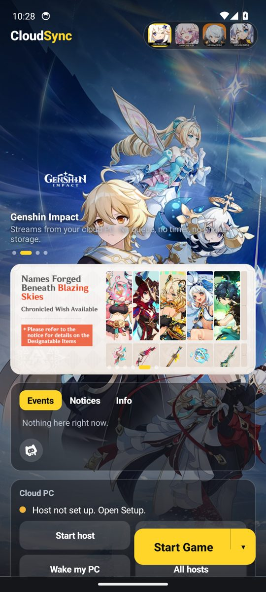
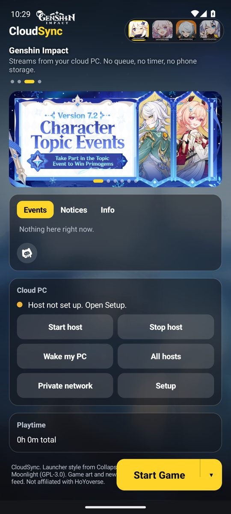
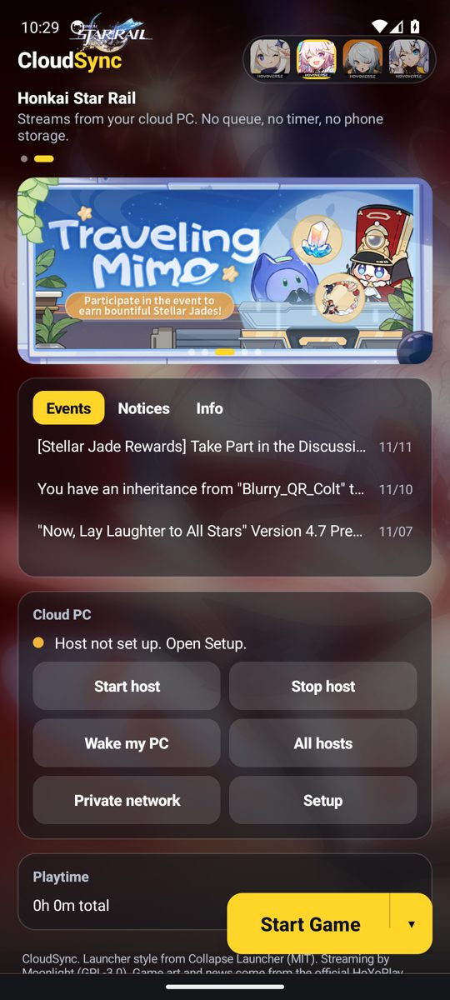

# REA check of the CloudSync APK

Static analysis of the shipped app with [REA](https://github.com/mpsamp-open/rea) (`rea-agents` 6.5.0, JADX headless MCP 0.7.1, Java 17). Provenance: **binary-based** for the APK facts, **observed-behavior** for the emulator screenshots.

Target: `cloudsync-debug.apk`, SHA-256 `0c2fe2eaa0dc0441032c4b23cb0378491ee1354f6c5a0369cbb80b893b2dab5c` (build run 45500679859). Full Evidence records are in [`rea/`](rea/).

| Question | Answer | Evidence |
| --- | --- | --- |
| Package and SDK | `com.limelight.cloudsync`, minSdk 21, targetSdk 36, compileSdk 37 | `ev_17f374f1...` (inspect-android-package) |
| Which activity opens from the app drawer | `com.limelight.cloudsync.CloudSyncActivity` has `MAIN` + `LAUNCHER`; Moonlight's `PcView` keeps only the TV (leanback) launcher | same |
| Permissions | INTERNET, ACCESS_NETWORK_STATE, VIBRATE, WAKE_LOCK, ACCESS_WIFI_STATE, CAPTURE_KEYBOARD, TV EPG read/write, CHANGE_WIFI_MULTICAST_STATE (max SDK 33). No location, contacts, storage or SMS | same |
| Launcher features present in the DEX | 135 methods incl. `applyParallax`, `onSensorChanged`, `setBlur`, `onScrolled`, `showBackground`, `showBanner`, `renderNews`, `renderSocial`, `selectGame`, `play`, `dispatch`, `wake`, `updatePlaytime` | `ev_e6f912ed...` (inspect-android-class) |
| Blur | API 31+: `RenderEffect.createBlurEffect(24dp)`; older: 1/24 downscale then upscale | `ev_223bd746...` (setBlur) |
| Blur on scroll | `bgBlur` alpha = `min(1, scrollY / 260dp)`, then parallax update | `ev_2673d37d...` (onScrolled) |

Emulator run (Pixel 6 profile, API 34, GitHub Actions): no `FATAL`/`AndroidRuntime` crash in logcat. Live HoYoPlay art, logo, banners and game switching rendered.

  

## Limits

* Static decompilation does not prove runtime behavior; the screenshots cover launch, one scroll and one game switch only.
* Signature verification was not performed (debug build).
* Start/Stop host, Play and Wake-on-LAN were not exercised: no host, token or LAN target in CI.
* Scope: only our own APK. The Genshin XAPK and HoYoverse clients were not analysed.
